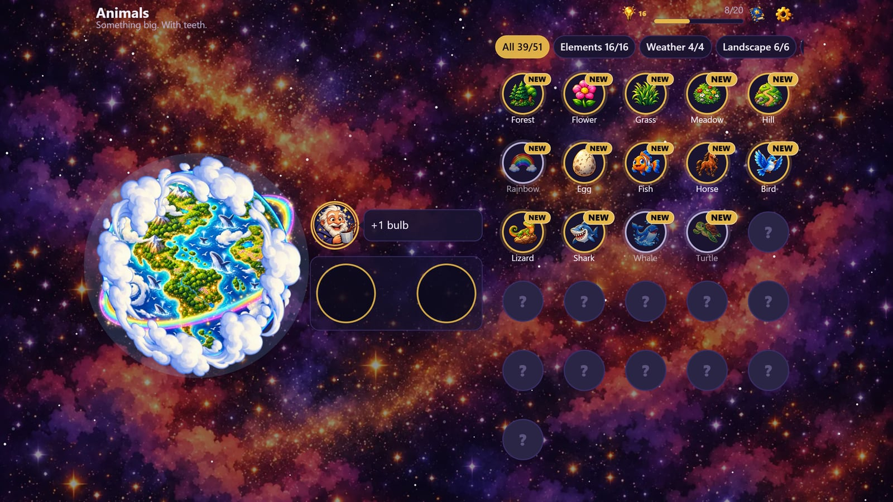
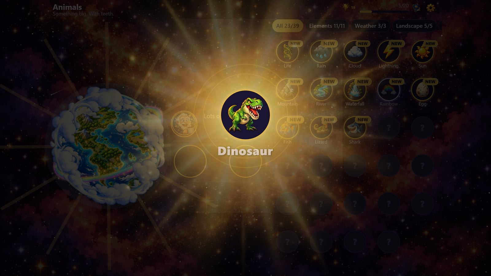
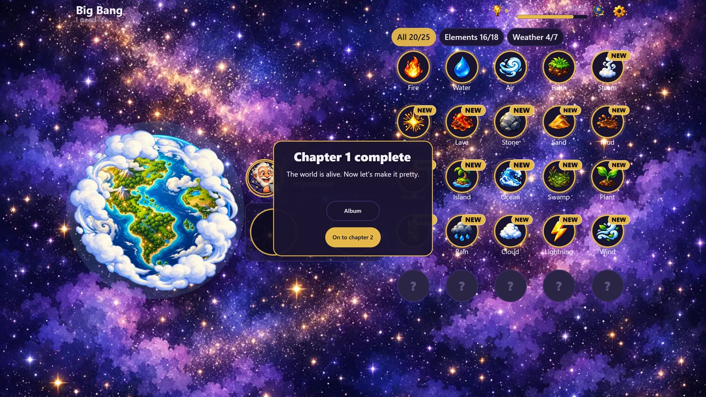
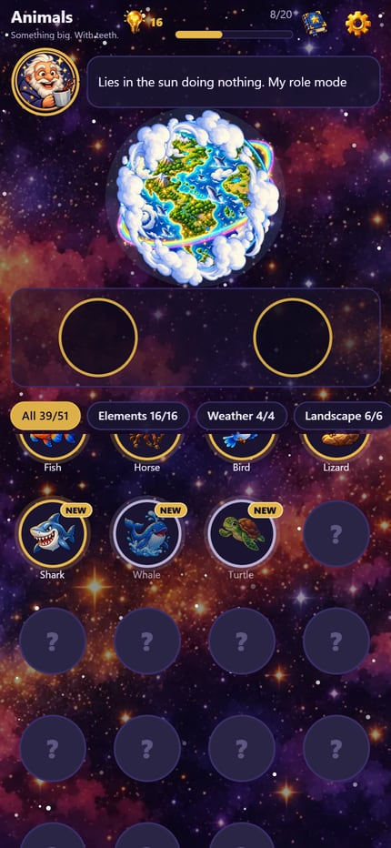

# Miximos
### Combine Elements & Create a World

**[▶ Play now in your browser](https://christophbarton1.github.io/miximos-play/)**: free, no download, works on phone and desktop.

## About

Start with **fire, water, air and earth**. Drag two elements onto the workbench and combine them. Steam, lava, life, rainbows, sharks, dinosaurs: **65 elements** are waiting across three chapters.

An old cosmic creator with a coffee mug watches every discovery. He comments with a dry one-liner and shares a real fun fact. In the middle of the screen, **your planet grows with every find**: first a ball of molten lava, then oceans, forests and meadows, and finally a world of whales and dinosaurs.

## Features

- 🌍 **A planet that grows**: 12 painted stages, from lava to dinosaurs
- 🧪 **65 elements in 3 chapters**: *Big Bang*, *Nature*, *Animals*, each with its own goal
- 🧙 **A grumpy creator**: a one-liner for every discovery and a portrait that changes with his mood
- 💡 **Did you know?**: a short, true fact on every element card
- 🔦 **Hints when you are stuck**: earn light bulbs and spend them on a small or a big hint
- 📖 **Album** of everything you discovered, chapter by chapter
- 🎵 **Chill space soundtrack** that opens up as your world grows
- 📱 **Phone and desktop**: portrait and landscape, touch and mouse
- 🌐 **English and German**

## How to play

1. Drag an element from the grid onto the workbench.
2. Drag a second one next to it. If they match, something new appears.
3. Work towards the chapter goal shown at the top. *Chapter 1: "I need life."*
4. Stuck? Tap the light bulb.

## Chapters

| # | Chapter | Goal | New |
|---|---|---|---|
| 1 | Big Bang | Life | 21 elements: basics and weather |
| 2 | Nature | Rainbow | 20 elements: landscapes and plants |
| 3 | Animals | Dinosaur | 20 elements: from eggs to sharks |
| 4 | Stone Age | *coming soon* | |

## Under the hood

- HTML5 game: TypeScript, [PixiJS](https://pixijs.com) (WebGL) and [GSAP](https://gsap.com)
- **2 MB to start**: later chapters load in the background
- Built for **YouTube Playables**, with the Playables SDK integrated (cloud save, pause/resume, audio and ads). This page hosts the plain web build.
- Progress is saved in your browser. Add `?neu` to the URL to start over.

## Credits

Game design, code and texts: **Christoph Barton – cWorkDigital** (Austria)
Art: generated with AI image tools from our own concept art and prompts
Soundtrack "Gardening the Night Sky": generated with Google Gemini (Lyria)

© 2026 Christoph Barton – cWorkDigital. All rights reserved. This repository hosts the compiled game for playing in the browser. It is not open source, and the code and assets may not be reused.

---

🇩🇪 **Deutsch:** Miximos ist ein Kombinier-Spiel. Aus Feuer, Wasser, Luft und Erde entsteht Schritt für Schritt eine ganze Welt. [Jetzt im Browser spielen](https://christophbarton1.github.io/miximos-play/), kostenlos am Handy und am PC. Das Spiel startet automatisch auf Deutsch, wenn dein Browser auf Deutsch eingestellt ist.
